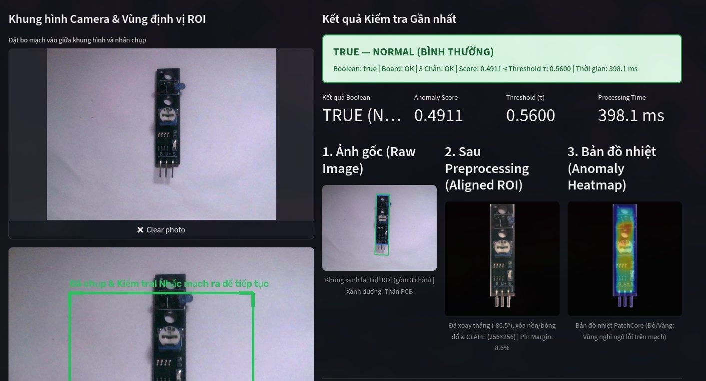

# Hệ thống Phát hiện Bất thường Bo mạch Cảm biến LM393 (PatchCore + 3-Pin Inspector)

Hệ thống kiểm tra ngoại quan tự động cho module cảm biến **LM393**, kết hợp **PatchCore (`wide_resnet50_2`)** kiểm tra bề mặt linh kiện SMD/IC/biến trở và **PinInspector** đo kiểm hình học riêng 3 chân cắm kim loại ở đáy mạch.



---

## 1. Tính năng chính

- **Tiền xử lý thông minh (`BoardAligner`)**: Tự động tách nền chống bóng đổ (flat-field + multi-Otsu), xoay thẳng bo mạch về chuẩn đứng (kể cả khi đặt nghiêng hoặc ngược 180°), cân bằng trắng Gray-World & CLAHE.
- **Kiểm tra kép 2 tầng (`is_normal = board_ok AND pins_ok`)**:
  1. **Bề mặt PCB (`PatchCore`)**: Phát hiện mất/che linh kiện (LED, biến trở 103, IC LM393, tụ/trở SMD), dị vật, trầy xước và xuất bản đồ nhiệt (Anomaly Heatmap).
  2. **Kiểm tra 3 chân cắm (`PinInspector`)**: Đo số lượng chân, chiều dài, độ rộng, góc nghiêng/cong và khoảng cách từng chân so với chuẩn hiệu chuẩn (`weights/pin_metadata.json`).
- **Giao diện Web trực quan (`Streamlit`)**:
  - **Phase 1 (Upload / Ảnh mẫu)**: Kèm sẵn **6 ảnh thực tế đại diện** trong `samples/` (đủ ca Normal và các lỗi linh kiện/chân cắm) để test ngay sau khi clone mà không cần camera.
  - **Phase 2 (Camera Auto-Trigger & Manual)**: Hỗ trợ Webcam trình duyệt, USB Webcam OpenCV (tự động chụp khi mạch đứng yên ổn định 10 frames trong vùng ROI), hoặc chế độ mô phỏng.
  - **Tinh chỉnh nóng (Live Calibration)**: Kéo thanh trượt `Threshold τ` cập nhật kết quả `TRUE/FALSE` tức thì (`O(1)`) không cần chạy lại model.

---

## 2. Yêu cầu hệ thống

- **Hệ điều hành**: Windows 10/11, Linux (Ubuntu 20.04+), hoặc macOS.
- **Python**: Khuyến nghị **Python 3.10 – 3.12** (đã tích chọn *Add Python to PATH* trên Windows).
- **Phần cứng**: Chạy mượt trên **CPU thông thường** (~150–400 ms/ảnh) hoặc tăng tốc tự động nếu máy có **GPU NVIDIA (CUDA)**.
- **Mạng Internet (lần chạy đầu tiên)**: Lần đầu khởi tạo model, Torchvision sẽ tự tải backbone chuẩn `wide_resnet50_2` (~132 MB) về cache máy và các lần sau chạy hoàn toàn offline.

---

## 3. Cài đặt & Chạy nhanh

### Bước 1: Clone repository về máy

```bash
git clone https://github.com/huudangg0204/Chip_detection.git
cd Chip_detection
```

### Bước 2: Khởi chạy tự động bằng 1 lệnh (Khuyên dùng)

- **Trên Windows** (nhấp đúp file hoặc chạy trong CMD / PowerShell):
  ```bat
  scripts\run_windows.bat
  ```
- **Trên Linux / macOS**:
  ```bash
  bash scripts/run_linux.sh
  ```

Script sẽ tự động tạo môi trường ảo `.venv`, cài đặt thư viện trong `requirements.txt` và mở trình duyệt tại địa chỉ **`http://localhost:8501`**.

---

### (Tùy chọn) Cài đặt thủ công từng lệnh

Nếu muốn tự quản lý môi trường ảo hoặc cài bản **PyTorch CPU gọn nhẹ (~180 MB thay vì bản CUDA ~2.5 GB)** cho laptop kỹ thuật không có card rời NVIDIA:

**Windows (PowerShell / CMD):**
```powershell
python -m venv .venv
.venv\Scripts\activate
python -m pip install --upgrade pip

# (Mẹo tùy chọn cho máy không có GPU NVIDIA - tải cực nhanh):
pip install torch torchvision --index-url https://download.pytorch.org/whl/cpu

# Cài các thư viện còn lại của dự án:
pip install -r requirements.txt

# Mở giao diện Web UI:
streamlit run src/ui/app.py
```

**Linux / macOS:**
```bash
python3 -m venv .venv
source .venv/bin/activate
python -m pip install --upgrade pip
pip install -r requirements.txt
streamlit run src/ui/app.py
```

---

## 4. Hướng dẫn Test nhanh cho Team Kỹ thuật Chip

1. **Kiểm tra trạng thái nạp Model (thanh bên trái – Sidebar)**:
   - Xác nhận dòng trạng thái màu xanh: `Đã nạp trọng số: weights/patchcore_best.ckpt` và `Feature Backend: torch_backbone`.
2. **Test trên bộ ảnh mẫu có sẵn (Tab 1 – Phase 1)**:
   - Tại ô **"Hoặc chọn nhanh ảnh trong bộ Dataset / Mẫu"**, lần lượt chọn thử 6 kịch bản thực tế đã đóng gói sẵn:
     - `normal_val_001.jpg` → Kỳ vọng **TRUE — NORMAL** (`Board: OK | 3 Chân: OK`).
     - `anomaly_test_005.jpg` (Che biến trở 103) → Kỳ vọng **FALSE — ANOMALY** (Heatmap đỏ vùng biến trở giữa mạch).
     - `anomaly_test_007.jpg` (Che IC LM393) → Kỳ vọng **FALSE — ANOMALY** (Heatmap đỏ vùng IC LM393).
     - `anomaly_test_001.jpg` (Che cụm LED) → Kỳ vọng **FALSE — ANOMALY**.
     - `anomaly_test_003.jpg` & `anomaly_test_011.jpg` (Dị vật / Cong chân cắm) → Kỳ vọng **FALSE — ANOMALY**, mục **4. Kiểm tra riêng 3 chân** báo `NG` kèm lý do & số đo góc lệch/chiều dài từng chân.
3. **Test thực tế với Bo mạch & Camera (Tab 2 – Phase 2)**:
   - Đặt bo mạch lên **nền giấy trắng/sáng phẳng, không bóng lóa**, ánh sáng tỏa đều từ phía trên (tránh 1 đèn chiếu xiên gây bóng gắt sát cạnh mạch).
   - Đảm bảo **toàn bộ thân mạch và đủ 3 chân kim loại** nằm trọn trong khung xanh ROI, cách mép khung tối thiểu ~5%.
   - Có thể chọn **"Webcam Trình duyệt (`st.camera_input`)"** để chụp từng tấm hoặc **"USB Webcam OpenCV"** với chế độ **Auto-Trigger** (giữ mạch đứng yên 10 frames hệ thống tự chụp và chấm điểm).

---

## 5. Chạy bộ kiểm thử tự động (Unit & E2E Tests)

Để xác nhận toàn bộ pipeline tiền xử lý, state machine của camera, PatchCore inference và kiểm tra 3 chân hoạt động chính xác trên máy vừa clone:

```bash
# Kích hoạt .venv trước, sau đó chạy:
pytest -v
```

Kiểm tra chất lượng mã nguồn (linter):
```bash
ruff check src tests
```

---

## 6. Cấu trúc thư mục dự án

```text
Chip_detection/
├── configs/
│   └── patchcore_chip.yaml       # Tham số cấu hình Model, Preprocessing, PinCheck & Camera ROI
├── weights/
│   ├── patchcore_best.ckpt       # Trọng số Memory Bank PatchCore đã huấn luyện sẵn
│   ├── metadata.json             # Ngưỡng tối ưu (optimal_threshold) & thang chuẩn hóa điểm
│   └── pin_metadata.json         # Thông số hiệu chuẩn hình học cho 3 chân cắm
├── samples/                      # 6 ảnh chụp thực tế đại diện (Normal + các lỗi linh kiện/chân)
├── image/                        # Ảnh mẫu cơ bản dùng cho regression tests
├── src/
│   ├── acquisition/              # Đọc ảnh & State Machine tự động chụp qua Camera (CameraTrigger)
│   ├── preprocessing/            # Tách nền chống bóng, xoay thẳng 0°/180°, CLAHE (BoardAligner)
│   ├── inference/                # PatchCore Inspector + Geometric 3-Pin Inspector
│   ├── training/                 # Script huấn luyện Coreset & hiệu chuẩn ngưỡng đánh giá
│   ├── ui/app.py                 # Giao diện Web Streamlit (3 Tabs)
│   └── schemas.py                # Data contracts (PreprocessResult, PinCheckResult, InspectionResult)
├── scripts/
│   ├── run_windows.bat           # Script cài đặt & khởi chạy 1 chạm trên Windows
│   └── run_linux.sh              # Script cài đặt & khởi chạy 1 chạm trên Linux/macOS
├── tests/                        # Bộ 4 file unit & end-to-end tests (pytest)
└── docs/                         # Tài liệu đặc tả kỹ thuật & báo cáo hệ thống
```

---

## 7. Xử lý sự cố thường gặp (Troubleshooting)

| Triệu chứng | Nguyên nhân & Cách khắc phục |
|---|---|
| Báo `Feature Backend: fallback_cv` ở Sidebar | Lần chạy đầu chưa tải được backbone `wide_resnet50_2` do mất mạng/tường lửa, hoặc chưa cài `torch`/`torchvision`. Hãy kiểm tra kết nối mạng rồi khởi động lại app. |
| Không mở được USB Camera ở `Index = 0` | Máy laptop thường gán camera tích hợp là `0` và webcam rời USB là `1` hoặc `2`. Hãy tăng **Chỉ số USB Camera (Index)** lên `1`/`2`, hoặc chuyển sang chế độ **Webcam Trình duyệt (`st.camera_input`)**. |
| Báo `NO BOARD DETECTED` dù đã đặt mạch | Đảm bảo mạch đặt trên nền sáng tương phản với PCB tối màu; có thể giảm nhẹ thanh trượt **Min Area Ratio** ở Sidebar nếu đặt camera ở khoảng cách xa. |
| Lỗi PowerShell chặn kích hoạt `.venv` trên Windows | Chạy lệnh `Set-ExecutionPolicy -Scope CurrentUser RemoteSigned` trong PowerShell hoặc dùng trực tiếp file `scripts\run_windows.bat`. |
