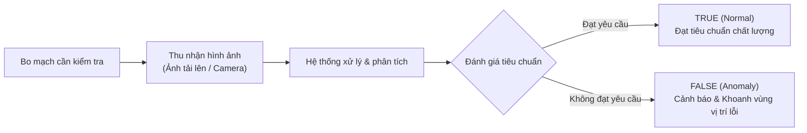
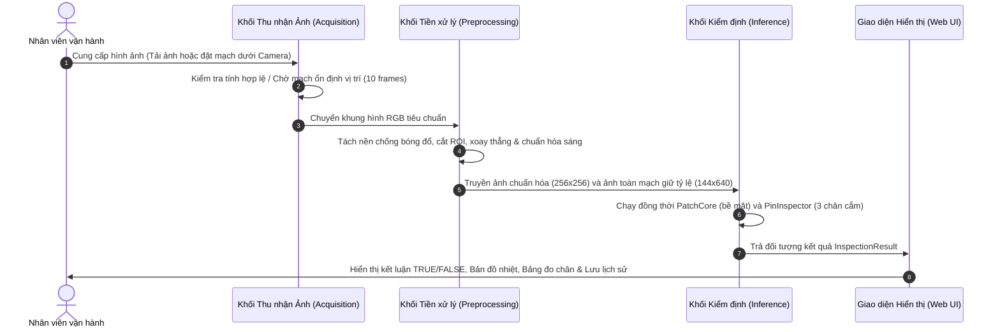

# BÁO CÁO TỔNG QUAN HỆ THỐNG KIỂM TRA NGOẠI QUAN BO MẠCH TỰ ĐỘNG

---

## 1. Tóm Tắt Tổng Quan

Trong quy trình sản xuất và lắp ráp linh kiện điện tử, công đoạn **Kiểm tra Ngoại quan (Visual Inspection)** có vai trò phát hiện và loại bỏ các bán thành phẩm lỗi trước khi đóng gói hoặc chuyển sang công đoạn tiếp theo. Phương pháp kiểm tra thủ công bằng mắt thường có hạn chế về tốc độ, tính nhất quán giữa các ca làm việc và khả năng phát hiện các linh kiện dán bề mặt (SMD) có kích thước rất nhỏ (1 – 2 mm).

**Hệ thống Kiểm tra Ngoại quan Bo mạch Tự động (Chip Anomaly Detection System)** được phát triển nhằm tự động hóa quy trình kiểm định thông qua xử lý ảnh và trí tuệ nhân tạo (Computer Vision & Deep Learning). Hệ thống thực hiện các chức năng chính sau:

1. **Tự động hóa khâu phân loại chất lượng:** Tiếp nhận hình ảnh bo mạch từ tệp ảnh tĩnh hoặc từ camera giám sát, phân tích và đưa ra kết luận đạt chuẩn (`TRUE` / `Normal`) hoặc không đạt chuẩn (`FALSE` / `Anomaly`) trong khoảng 0.3 – 0.8 giây.
2. **Kiểm tra toàn diện bề mặt và cấu trúc cơ học:** Kết hợp mô hình học sâu để phát hiện khuyết tật trên bề mặt bo mạch (thiếu linh kiện, lệch vị trí, dị vật, hư hỏng bề mặt) và thuật toán hình học để kiểm tra độ chính xác của các chân cắm kim loại (thiếu chân, cong chân, sai lệch khoảng cách).
3. **Trực quan hóa vị trí bất thường:** Cung cấp bản đồ nhiệt (Heatmap) đánh dấu khu vực nghi ngờ có lỗi trên bo mạch và bảng thông số đo đạc chi tiết cho từng chân cắm, hỗ trợ nhân sự QC xác minh nguyên nhân nhanh chóng.
4. **Hiệu chỉnh linh hoạt theo tiêu chuẩn lô hàng:** Cho phép người quản lý điều chỉnh ngưỡng quyết định chất lượng trực tiếp trên giao diện vận hành mà không cần can thiệp vào mã nguồn hay huấn luyện lại mô hình.



---

## 2. Bối Cảnh Nghiệp Vụ & Các Vấn Đề Thực Tế

### 2.1. Đối tượng kiểm tra
Đối tượng kiểm định mục tiêu hiện tại của hệ thống là **Module cảm biến hồng ngoại LM393**. Về mặt cấu tạo vật lý, bo mạch gồm hai khu vực có đặc tính kiểm tra khác nhau:
- **Khu vực thân mạch in (PCB):** Nền mạch màu tối, gắn vi mạch điều khiển (IC LM393), biến trở tinh chỉnh (103), 2 đèn LED và hệ thống các điện trở, tụ điện dán (SMD) kích thước nhỏ.
- **Khu vực chân cắm kết nối (Header Pins):** Gồm 3 chân kim loại ở phần đuôi mạch (`G`, `V+`, `S`) dùng để kết nối vật lý với thiết bị ngoại vi.

### 2.2. Các thách thức trong môi trường kiểm tra thực tế
Qua khảo sát thực tế, quá trình thu nhận và phân tích hình ảnh bo mạch gặp 4 vấn đề chính cần được giải quyết bằng phần mềm:

| Vấn đề thực tế | Tác động đến kết quả kiểm tra | Giải pháp kỹ thuật được áp dụng |
| :--- | :--- | :--- |
| **1. Tỷ lệ diện tích bo mạch nhỏ** | Bo mạch chỉ chiếm dưới 10% tổng diện tích khung hình camera, làm giảm độ phân giải tại vùng chứa linh kiện SMD nhỏ. | Tự động xác định đường bao bo mạch, cắt sát vùng quan tâm (Auto-ROI Crop) và chuẩn hóa kích thước trước khi phân tích. |
| **2. Sai lệch vị trí và góc đặt mạch** | Khi thao tác đặt mạch thủ công, bo mạch có thể bị lệch tâm, nghiêng góc hoặc đặt ngược đầu $180^\circ$. | Tự động tính góc nghiêng để xoay thẳng đứng bo mạch (Deskew) và nhận diện cụm đèn LED đầu mạch để đồng nhất chiều hướng $180^\circ$. |
| **3. Biến thiên ánh sáng và bóng đổ** | Ánh sáng phòng thay đổi hoặc đèn chiếu xiên tạo ra vùng bóng đổ sát cạnh bo mạch, gây nguy cơ nhận diện nhầm bóng đổ là lỗi bề mặt. | Ước lượng độ sáng nền và phân ngưỡng đa lớp (Multi-Otsu 3 lớp) để tách biệt vùng bóng đổ khỏi thân mạch; kết hợp cân bằng sáng cục bộ (CLAHE). |
| **4. Đặc thù hình học của 3 chân cắm** | Chân cắm có tiết diện mảnh, độ phản xạ ánh sáng cao. Mô hình AI toàn ảnh dễ bỏ sót lỗi mất chân hoặc cong chân do diện tích chân quá nhỏ so với toàn mạch. | Tách riêng vùng 3 chân cắm với độ phân giải giữ nguyên tỷ lệ và xử lý bằng bộ kiểm tra hình học độc lập (Pin Inspector). |

---

## 3. Phương Pháp Tiếp Cận Cốt Lõi: Phát Hiện Bất Thường Đơn Lớp (One-Class Anomaly Detection)

### 3.1. Hạn chế của phương pháp phân loại lỗi truyền thống
Phương pháp phân loại có giám sát truyền thống yêu cầu thu thập đầy đủ hình ảnh của từng loại lỗi (thiếu linh kiện, lệch linh kiện, cháy hỏng, trầy xước, dị vật...) với số lượng lớn để huấn luyện mô hình. Trong thực tế sản xuất, các dạng lỗi phát sinh rất đa dạng và khó dự đoán trước toàn bộ, dẫn đến việc thu thập dữ liệu lỗi đầy đủ là không khả thi.

### 3.2. Nguyên lý hoạt động của mô hình PatchCore trong hệ thống
Hệ thống tiếp cận theo hướng **Học đặc trưng chuẩn (Normal-only / One-Class Learning)** thông qua mô hình **PatchCore**:
- **Giai đoạn huấn luyện (Training):** Hệ thống chỉ sử dụng tập hình ảnh của các **bo mạch đạt chuẩn (Normal)** chụp dưới nhiều điều kiện ánh sáng khác nhau. Mô hình chia ảnh bo mạch thành các vùng cục bộ nhỏ (patches), trích xuất đặc trưng hình ảnh qua mạng học sâu (`wide_resnet50_2`) và lưu các đặc trưng chuẩn đại diện vào cơ sở dữ liệu mẫu (**Memory Bank**).
- **Giai đoạn kiểm tra (Inference):** Khi nhận hình ảnh bo mạch mới, hệ thống trích xuất đặc trưng tại từng vùng nhỏ trên ảnh và tính khoảng cách sai khác so với cơ sở dữ liệu mẫu trong Memory Bank.
- **Lợi ích nghiệp vụ:**
  - Tiết kiệm chi phí và thời gian thu thập mẫu lỗi khi triển khai thực tế (chỉ cần 30 – 50 ảnh bo mạch chuẩn để thiết lập mô hình).
  - Có khả năng phát hiện **cả những dạng khuyết tật mới chưa từng xuất hiện trước đây**, miễn là chúng tạo ra sự khác biệt về mặt hình ảnh so với bo mạch chuẩn.

---

## 4. Kiến Trúc Kiểm Định Hai Tầng (Dual-Engine Architecture)

Để đảm bảo độ chính xác trên cả phần thân mạch lẫn phần chân cắm, hệ thống được thiết kế với hai bộ kiểm tra chuyên biệt hoạt động song song sau bước tiền xử lý:

```mermaid
flowchart TD
    RawImg["Hình ảnh đầu vào (Ảnh tĩnh / Khung hình Camera)"] --> Preprocess["Bộ Tiền Xử Lý Hình Ảnh (BoardAligner)<br>• Khử bóng đổ • Cắt sát biên • Xoay thẳng • Cố định chiều 180°"]
    
    Preprocess --> Engine1["TẦNG 1: Kiểm Tra Bề Mặt Bo Mạch (PatchCore)<br>Đánh giá linh kiện trên mặt PCB (IC, Biến trở, LED, SMD)"]
    Preprocess --> Engine2["TẦNG 2: Kiểm Tra Hình Học Chân Cắm (Pin Inspector)<br>Đo lường 3 chân kim loại (Số lượng, Chiều dài, Góc lệch, Khoảng cách)"]
    
    Engine1 --> Score1{"Đánh giá bề mặt<br>(Anomaly Score <= Ngưỡng tau)"}
    Engine2 --> Score2{"Đánh giá chân cắm<br>(Đạt toàn bộ tiêu chí hình học)"}
    
    Score1 -->|Đạt (board_ok = True)| Decision{"Tổng hợp kết quả"}
    Score1 -->|Không đạt (board_ok = False)| Decision
    Score2 -->|Đạt (pins_ok = True)| Decision
    Score2 -->|Không đạt (pins_ok = False)| Decision
    
    Decision -->|Cả 2 cùng Đạt| Normal["KẾT QUẢ: NORMAL (TRUE)<br>Bo mạch đạt tiêu chuẩn"]
    Decision -->|1 trong 2 Không đạt| Anomaly["KẾT QUẢ: ANOMALY (FALSE)<br>Báo cáo chi tiết bộ phận gây lỗi"]
```

### 4.1. Tầng 1: Kiểm tra bề mặt thân mạch (PatchCore Surface Inspection)
- **Phạm vi kiểm tra:** Toàn bộ bề mặt PCB chứa linh kiện điện tử.
- **Đầu ra:**
  - **Điểm bất thường (`anomaly_score`):** Giá trị số thực chuẩn hóa (thường từ `0.0` đến `1.0`). Điểm càng cao thể hiện mức độ sai khác so với mẫu chuẩn càng lớn.
  - **Bản đồ nhiệt (`heatmap_overlay_rgb`):** Biểu diễn phân bố mức độ bất thường trên từng vùng của bo mạch (màu xanh lam thể hiện vùng bình thường, màu vàng/đỏ thể hiện vùng có dấu hiệu bất thường).

### 4.2. Tầng 2: Kiểm tra hình học 3 chân cắm (Dedicated Pin Inspector)
- **Phạm vi kiểm tra:** Khu vực 3 chân kim loại ở đáy bo mạch (`G (Trái)`, `V+ (Giữa)`, `S (Phải)`).
- **Các tiêu chí đo lường tự động:**
  1. **Số lượng chân (`pin_count`):** Kiểm tra sự hiện diện của đủ 3 chân cắm.
  2. **Chiều dài & Độ rộng (`length_px`, `width_px`):** Đối chiếu kích thước từng chân với giới hạn tối thiểu và tối đa đã hiệu chuẩn (phát hiện chân bị gãy ngắn hoặc bị che khuất).
  3. **Góc nghiêng (`angle_deg`):** Đo độ lệch góc của trục từng chân so với phương thẳng đứng (phát hiện lỗi cong chân, vẹo chân).
  4. **Khoảng cách giữa các chân (`spacing_px`):** Kiểm tra khoảng cách tâm giữa các chân liền kề và độ đối xứng để đảm bảo chân cắm khớp với đầu nối tiêu chuẩn.
- **Đầu ra:** Trạng thái đạt/không đạt (`pins_ok`), hình ảnh khoanh vùng từng chân (màu xanh cho chân đạt, màu đỏ cho chân lỗi) và bảng thông số đo lường chi tiết.

### 4.3. Quy tắc tổng hợp kết quả (Decision Logic)
Hệ thống áp dụng điều kiện kết hợp nghiêm ngặt (`AND` logic):
$$\text{is\_normal} = \text{board\_ok} \land \text{pins\_ok}$$
Trong đó:
- $\text{board\_ok} = (\text{anomaly\_score} \le \tau)$, với $\tau$ là ngưỡng quyết định hiện hành.
- $\text{pins\_ok} = \text{True}$ khi và chỉ khi cả 3 chân cắm vượt qua tất cả các tiêu chí hình học.
- Nếu bất kỳ một trong hai tầng kiểm tra phát hiện lỗi, kết quả chung của bo mạch sẽ là **`FALSE` (Anomaly)** kèm thông báo nêu rõ nguyên nhân (lỗi bề mặt bo mạch, lỗi chân cắm, hoặc cả hai).

---

## 5. Luồng Xử Lý Chi Tiết Của Hệ Thống (End-to-End Pipeline)

Quy trình xử lý một mẫu kiểm tra diễn ra tuần tự qua 4 giai đoạn:



### Mô tả kỹ thuật từng giai đoạn theo góc nhìn nghiệp vụ:
1. **Giai đoạn 1 – Thu nhận dữ liệu (`src/acquisition/`):**
   - Kiểm tra định dạng, kích thước tệp ảnh hoặc đọc luồng video từ camera.
   - Trong chế độ camera tự động, bộ quản lý trạng thái (`CameraTrigger`) theo dõi vùng kiểm tra (ROI). Hệ thống chỉ chụp ảnh khi phát hiện có bo mạch nằm yên ổn định liên tiếp qua 10 khung hình (tránh hiện tượng nhòe ảnh do chuyển động tay của người thao tác), sau đó chuyển sang trạng thái chờ lấy mạch ra (`COOLDOWN_WAIT_EXIT`) để tránh chụp trùng lặp cùng một bo mạch.
2. **Giai đoạn 2 – Tiền xử lý và Chuẩn hóa (`src/preprocessing/`):**
   - Thực hiện tách nền loại bỏ bóng đổ, tìm khung bao nhỏ nhất quanh thân mạch, mở rộng vùng đáy để lấy trọn vẹn 3 chân cắm.
   - Xoay dựng đứng bo mạch, kiểm tra vị trí cụm linh kiện đầu mạch để xoay $180^\circ$ nếu mạch bị đặt ngược.
   - Cân bằng trắng (Gray-World) và cân bằng độ tương phản cục bộ (CLAHE) nhằm giảm thiểu ảnh hưởng của sự thay đổi nguồn sáng môi trường.
   - Trường hợp ảnh đầu vào không chứa bo mạch hoặc diện tích/tỷ lệ khung hình nằm ngoài giới hạn hợp lệ, hệ thống dừng xử lý sớm và trả về trạng thái `NO_BOARD_DETECTED`.
3. **Giai đoạn 3 – Suy luận và Đo lường (`src/inference/`):**
   - Thực thi mô hình PatchCore trên ảnh bề mặt đã xóa nền nhiễu.
   - Thực thi bộ đo hình học trên vùng chân cắm.
   - Tổng hợp điểm số, đối chiếu với ngưỡng $\tau$ và tạo thông điệp kết quả chi tiết.
4. **Giai đoạn 4 – Hiển thị và Ghi nhận dữ liệu (`src/ui/`):**
   - Trình bày kết quả trực quan trên màn hình vận hành và ghi vào danh sách lịch sử của phiên làm việc.

---

## 6. Giao Diện Vận Hành & Các Chế Độ Sử Dụng (User Interface)

Giao diện điều khiển được xây dựng trên nền tảng Web (Streamlit), chia thành **Bảng cấu hình bên trái (Sidebar)** và **3 phân hệ chức năng chính (Tabs)**:

(chèn ảnh vào ở đây khi có ảnh)

### 6.1. Phân hệ 1 – Kiểm tra qua Ảnh tải lên (Phase 1: Image-based Inspection)
- **Mục đích sử dụng:** Phục vụ công tác kiểm tra mẫu đơn lẻ, đánh giá lại ảnh lưu trữ hoặc kiểm thử chất lượng định kỳ.
- **Thao tác:** Người dùng tải tệp ảnh (`.jpg`, `.jpeg`, `.png`) từ máy tính hoặc chọn mẫu có sẵn trong hệ thống và nhấn nút phân tích.

### 6.2. Phân hệ 2 – Kiểm tra qua Camera (Phase 2: Camera-based Inspection)
- **Mục đích sử dụng:** Vận hành trực tiếp tại bàn kiểm tra sản xuất.
- **Chế độ hỗ trợ:**
  - **Tự động (Auto-Trigger):** Hệ thống tự động nhận diện khi nhân viên đặt bo mạch vào khung giới hạn (ROI), đợi bo mạch ổn định vị trí và tự động chụp ảnh phân tích.
  - **Thủ công (Manual Capture):** Cho phép nhân viên chủ động bấm nút chụp khung hình hiện tại.
- **Quản lý phiên làm việc:** Lưu trữ bảng lịch sử các lần kiểm tra trong ca (thời gian, chế độ chụp, điểm bất thường, ngưỡng áp dụng, kết quả `TRUE`/`FALSE`, thời gian xử lý).

### 6.3. Phân hệ 3 – Công cụ Chụp và Quản lý Dữ liệu (Dataset Helper)
- **Mục đích sử dụng:** Hỗ trợ đội ngũ vận hành và QC thu thập thêm ảnh mẫu mới (ảnh chuẩn để huấn luyện hoặc ảnh lỗi để kiểm thử) theo đúng tiêu chuẩn kỹ thuật.
- **Cơ chế kiểm soát chất lượng dữ liệu:** Khi chụp hoặc tải ảnh lên, hệ thống chạy thử bộ tiền xử lý `BoardAligner` ngay lập tức để xác nhận ảnh có tách được bo mạch và xoay thẳng hợp lệ hay không trước khi cho phép lưu vào thư mục dữ liệu.

### 6.4. Cơ chế hiệu chỉnh ngưỡng quyết định theo thời gian thực (Live Threshold Adjustment)
- Trên thanh công cụ bên trái, người vận hành có thể điều chỉnh **Ngưỡng quyết định ($\tau$)** và **Độ nhạy kiểm tra chân cắm (Pin Sensitivity)**.
- Khi thay đổi ngưỡng $\tau$, hệ thống tính toán lại kết luận `TRUE`/`FALSE` cho mẫu hiện tại và cập nhật lại toàn bộ bảng lịch sử kiểm tra trong phiên ngay lập tức ($O(1)$) mà không cần chạy lại quá trình trích xuất đặc trưng AI. Tính năng này giúp bộ phận QC dễ dàng cân chỉnh mức độ chặt chẽ của tiêu chuẩn kiểm tra tùy theo yêu cầu của từng đơn hàng.

---

## 7. Phạm Vi Giới Hạn Hiện Tại & Định Hướng Mở Rộng

### 7.1. Phạm vi và điều kiện vận hành tiêu chuẩn (Operational Constraints)
Để hệ thống đạt độ chính xác như thiết kế, môi trường vận hành cần tuân thủ các điều kiện sau:
- **Góc chụp camera:** Cố định góc chụp vuông góc ($90^\circ$ Top-down) từ trên xuống mặt phẳng đặt mạch; hệ thống không thiết kế cho góc chụp nghiêng 3D tự do.
- **Phông nền đặt mạch:** Sử dụng phông nền sáng màu, đồng nhất (như nền trắng nhám) để tối ưu hóa độ tương phản với thân bo mạch tối màu.
- **Quản lý thay đổi mẫu mã:** Khi thay đổi sang dòng bo mạch có thiết kế vật lý khác, cần thu thập lại bộ ảnh chuẩn (30 – 50 ảnh) và thực hiện huấn luyện lại trọng số mô hình.

### 7.2. Định hướng phát triển tiếp theo (Future Roadmap)
Thêm vào sau

## Phụ Lục: Chú Thích & Giải Thích Thuật Ngữ Chuyên Ngành (Glossary)

Phần chú thích dưới đây giải thích các thuật ngữ kỹ thuật, viết tắt và khái niệm chuyên ngành xuất hiện trong báo cáo để hỗ trợ người đọc tra cứu nhanh:

### A. Thuật ngữ Điện tử & Kiểm soát Chất lượng
| Thuật ngữ | Giải thích chi tiết |
| :--- | :--- |
| **Visual Inspection (Kiểm tra ngoại quan)** | Phương pháp kiểm tra chất lượng sản phẩm thông qua quan sát hình thức bên ngoài (bằng mắt thường hoặc bằng hệ thống camera tự động) để phát hiện các khuyết tật vật lý. |
| **PCB (Printed Circuit Board)** | Bản mạch in (phần thân bo mạch màu tối), nơi gắn kết các linh kiện điện tử và đường dẫn truyền tín hiệu. |
| **SMD (Surface-Mount Device)** | Linh kiện điện tử dán bề mặt (như điện trở, tụ điện siêu nhỏ có kích thước 1 – 2 mm) được hàn trực tiếp lên bề mặt bản mạch PCB. |
| **IC LM393 & Biến trở 103** | Các linh kiện chính trên bo mạch mục tiêu: IC LM393 là vi mạch so sánh điện áp trung tâm; biến trở 103 là linh kiện màu xanh có vít xoay dùng để tinh chỉnh độ nhạy của cảm biến. |
| **Header Pins (Chân cắm kết nối)** | Cụm 3 chân kim loại (`G`, `V+`, `S`) nhô ra ở đuôi bo mạch, dùng để cấp nguồn và truyền tín hiệu ra thiết bị bên ngoài. |

### B. Thuật ngữ Xử lý Ảnh & Thị giác Máy tính (Computer Vision)
| Thuật ngữ | Giải thích chi tiết |
| :--- | :--- |
| **ROI (Region of Interest)** | "Vùng quan tâm" — khu vực khung hình chứa đối tượng cần phân tích (ví dụ: vùng đặt bo mạch dưới camera hoặc vùng cắt sát quanh thân mạch). |
| **Auto-ROI Crop** | Kỹ thuật tự động xác định vị trí bo mạch trong ảnh lớn và cắt bỏ phần phông nền thừa xung quanh. |
| **Deskew (Xoay làm thẳng)** | Kỹ thuật tính toán góc lệch của bo mạch khi đặt nghiêng và tự động xoay hình ảnh để dựng bo mạch về phương thẳng đứng chuẩn. |
| **Multi-Otsu (Phân ngưỡng đa lớp)** | Thuật toán tự động chia độ sáng hình ảnh thành 3 nhóm riêng biệt (Thân mạch tối – Bóng đổ trung gian – Phông nền sáng) nhằm loại bỏ bóng đổ ra khỏi hình ảnh bo mạch. |
| **Gray-World & CLAHE** | Các thuật toán cân bằng màu sắc (cân bằng trắng) và ổn định độ tương phản cục bộ trên ảnh, giúp hình ảnh bo mạch luôn rõ nét dù ánh sáng phòng thay đổi. |
| **Top-down ($90^\circ$)** | Góc chụp thẳng đứng từ trên nhìn vuông góc xuống mặt bàn đặt bo mạch. |

### C. Thuật ngữ Trí tuệ Nhân tạo (AI) & Trạng thái Hệ thống
| Thuật ngữ | Giải thích chi tiết |
| :--- | :--- |
| **One-Class Anomaly Detection** | Phương pháp phát hiện bất thường đơn lớp: mô hình chỉ học từ dữ liệu của sản phẩm đạt chuẩn (*Normal*), từ đó nhận diện mọi sai khác phát sinh là bất thường (*Anomaly*). |
| **PatchCore & Memory Bank** | **PatchCore** là mô hình AI chia ảnh bo mạch thành từng ô nhỏ (*patches*) để phân tích chi tiết; **Memory Bank** là kho dữ liệu lưu trữ các đặc trưng hình ảnh chuẩn dùng để đối chiếu khi kiểm tra. |
| **Backbone (`wide_resnet50_2`)** | Mạng nơ-ron học sâu đóng vai trò bộ trích xuất đặc trưng hình ảnh (nhận diện hình dạng, kết cấu, màu sắc của linh kiện ở mức độ chi tiết cao). |
| **Training & Inference** | **Training (Huấn luyện):** Quá trình hệ thống học và ghi nhớ mẫu chuẩn từ tập ảnh mẫu.<br>**Inference (Suy luận/Kiểm định):** Quá trình hệ thống vận hành thực tế để chấm điểm và phân loại bo mạch mới. |
| **`Normal` (`TRUE`)** | Kết luận của hệ thống khi bo mạch **Đạt chuẩn** (cả bề mặt mạch và 3 chân cắm đều đạt yêu cầu). |
| **`Anomaly` (`FALSE`)** | Kết luận của hệ thống khi bo mạch **Không đạt chuẩn** (phát hiện khuyết tật trên bề mặt hoặc sai lệch ở chân cắm). |
| **`NO_BOARD_DETECTED`** | Trạng thái thông báo không tìm thấy bo mạch hợp lệ trong khung hình kiểm tra. |
| **`Anomaly Score` (Điểm bất thường)** | Chỉ số định lượng mức độ khác biệt của bo mạch đang kiểm tra so với mẫu chuẩn (thang chuẩn hóa từ `0.0` đến `1.0`). Điểm càng cao thì khả năng lỗi càng lớn. |
| **`Threshold` ($\tau$ - Ngưỡng quyết định)** | Mốc giới hạn dùng để phân loại sản phẩm: nếu `Anomaly Score` $\le \tau$ thì bề mặt mạch được đánh giá là Đạt; nếu lớn hơn $\tau$ thì bị đánh giá là Lỗi. |
| **`Anomaly Heatmap` (Bản đồ nhiệt)** | Hình ảnh phủ màu trực quan hóa vị trí lỗi trên bo mạch: vùng màu xanh lam là bình thường, vùng màu vàng/đỏ chỉ thị vị trí có dấu hiệu lỗi. |
| **`BoardAligner` & `Pin Inspector`** | Tên hai module phần mềm trong hệ thống: `BoardAligner` phụ trách căn chỉnh và làm sạch ảnh; `Pin Inspector` phụ trách đo đạc hình học 3 chân cắm. |
| **`CameraTrigger` & `COOLDOWN_WAIT_EXIT`** | Cơ chế tự động chụp ảnh khi bo mạch nằm yên dưới camera. Trạng thái `COOLDOWN_WAIT_EXIT` là chế độ khóa tạm thời sau khi chụp xong, đợi nhân viên lấy mạch cũ ra mới tiếp tục chụp mạch mới. |
| **$O(1)$ (Thời gian hằng số)** | Thuật ngữ chỉ tốc độ tính toán tức thời: khi kéo thanh trượt đổi ngưỡng $\tau$, kết quả cập nhật ngay lập tức mà không mất thời gian chạy lại mô hình AI. |


